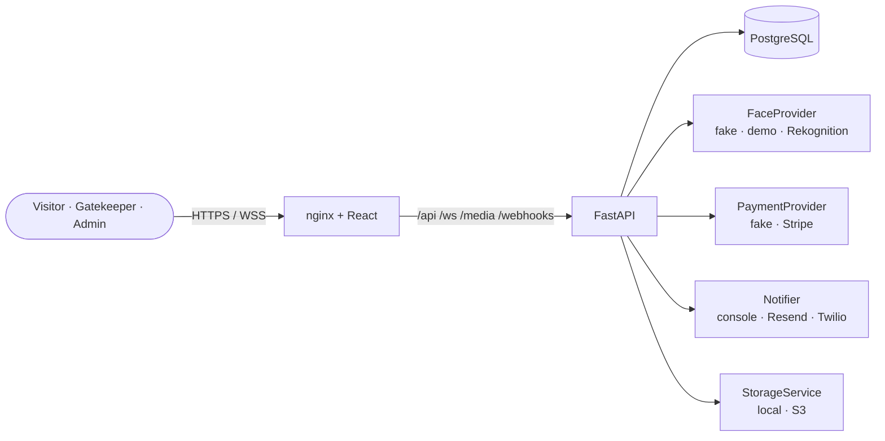

# BioAccess

Face-recognition entry for events. Visitors buy a ticket, pay online and receive it by email
with a QR code. Once, at home, they bind their face to the ticket with a webcam. On event day a
gate terminal recognizes them and lets each ticket in **exactly once**, with QR as the fallback,
while admins watch entries live.

> Academic project. External services run in test/sandbox modes; nothing here handles real money.

**Contents:** [Features](#features) · [Architecture](#architecture) · [Quick start](#quick-start) ·
[Configuration](#configuration) · [Demo walkthrough](#demo-walkthrough) · [Testing](#testing) ·
[Security & privacy](#security--privacy) · [Known limitations](#known-limitations) ·
[Project structure](#project-structure)

## Features

| Role | What they can do |
|---|---|
| **Visitor** | Register and log in · browse active events · buy a ticket (Stripe Checkout) · confirmation email with QR (+ SMS) · My tickets with QR · **face enrollment** with explicit consent, guided capture and quality tips |
| **Gatekeeper** | Gate terminal: pick event + gate · camera scans only when someone steps in · big green/red result with sound · QR fallback (USB scanners work) |
| **Admin** | Live dashboard over WebSocket (entries feed, KPIs, occupancy, entries per 30 min, denials by reason) · events (create, activate, close, cover upload) · audit logs with filters · users and role changes · face-match threshold |

The core rule: a face is bound to **one ticket** for **one event**. At the gate the face *is* the
ticket: the face provider returns which ticket it belongs to, and the backend admits that ticket
at most once, inside a locked transaction.

## Architecture



- **Layers:** router → service → repository. Routers only translate HTTP; rules live in services.
- **Every external service is an interface** with a free fake and a real implementation, chosen in `.env`.
- **Anti-passback:** the face search runs first (no lock held during the network call), then one short
  transaction does `SELECT … FOR UPDATE` on the ticket, re-checks it, marks it `ENTERED` and writes the
  access log. Proven with 10 parallel gates (face, and face + QR mixed).

Full diagrams for the project book (flows, state machine, data model, deployment):
**[docs/architecture.md](docs/architecture.md)**, with SVG exports in [docs/diagrams](docs/diagrams/).

**Stack:** Python 3.14, FastAPI, SQLAlchemy 2 + Alembic, PostgreSQL 15, Pydantic · React 19,
TypeScript, Vite, Tailwind, React Router · Docker Compose, nginx · pytest, Vitest + Testing Library.

## Quick start

You need Docker, Python 3.14 and Node 24. Copy the configuration first:

```bash
cp .env.example .env
python3 -c "import secrets; print(secrets.token_urlsafe(48))"   # paste as JWT_SECRET in .env
```

The defaults use fake/console providers, so **no accounts are needed** to run everything.

### Option A: development (hot reload)

```bash
docker compose up -d db                          # PostgreSQL only

cd backend
python3 -m venv .venv && .venv/bin/pip install -r requirements-dev.txt
.venv/bin/alembic upgrade head
.venv/bin/uvicorn app.main:app --reload          # http://localhost:8000/docs

cd ../frontend                                   # in a second terminal
npm install
npm run dev                                      # http://localhost:5173
```

The Vite dev server proxies `/api`, `/ws`, `/media` and `/webhooks` to the backend, so the browser
sees one origin. Browsers allow the camera on `localhost` without HTTPS.

### Option B: full stack in Docker (HTTPS)

```bash
sudo dnf install mkcert nss-tools                # once (or your OS's mkcert package)
./scripts/make-certs.sh                          # once: local CA + cert for localhost and your LAN IP
docker compose up --build                        # https://localhost
```

Only nginx is published; the backend runs migrations on start. Other devices on the network
(a gate laptop, a phone) can use `https://<LAN-IP>` after trusting the mkcert CA; set
`PUBLIC_URL` in `.env` to that address.

### Accounts

```bash
cd backend && .venv/bin/python -m app.cli.create_admin --email admin@example.com --name "Admin"
```

Visitors register in the app. **Gatekeepers** also register normally; an admin then promotes them
under **Admin → Users** (role dropdown). Role changes apply on the user's next request.

## Configuration

All settings are in [`.env.example`](.env.example), grouped and commented (a test keeps it in
sync with the code). Provider modes:

| Service | `.env` | Modes | Needs |
|---|---|---|---|
| Face recognition | `FACE_PROVIDER` | `fake` (tests: identical bytes only) · `demo` (webcam demos, **not** real recognition) · `rekognition` | AWS keys (IAM user limited to Rekognition) |
| Payments | `PAYMENT_PROVIDER` | `fake` · `stripe` | Stripe test keys; locally `stripe listen` (below) |
| Email | `EMAIL_PROVIDER` | `console` · `resend` | Resend API key |
| SMS | `SMS_PROVIDER` | `console` · `twilio` | Twilio trial account |
| Cover images | `STORAGE_PROVIDER` | `local` · `s3` | S3 bucket |

**Stripe webhooks locally** (keep running while testing payments):

```bash
stripe listen --events checkout.session.completed,checkout.session.async_payment_succeeded,checkout.session.async_payment_failed,checkout.session.expired \
  --forward-to localhost:8000/webhooks/payment              # Docker: https://localhost/webhooks/payment --skip-verify
```

If a webhook is missed anyway, the payment success page asks the backend to check the session
with Stripe directly, so a paid ticket never stays unpaid.

## Demo walkthrough

With `FACE_PROVIDER=demo` (no AWS needed), three browser windows:

1. **Admin:** Events → New event (starting soon) → **Activate**. Open the Dashboard (● Live).
2. **Visitor:** register → Events → **Buy ticket** → pay with `4242 4242 4242 4242` → "Payment received!"
   → My tickets shows the QR → **Set up face entry** → consent → photo → "Face entry is ready!".
3. **Gatekeeper:** `/gate` → pick the event and a gate name → step in front of the camera:
   **green "Welcome!" + name**; step in again: **red "Already entered"**. Try **QR fallback** too.
4. **Admin:** both scans appear instantly in the live feed; KPIs, occupancy and charts update.
   Logs shows every attempt; Settings changes the match threshold for the next scan.

The demo provider "recognizes" the most recently enrolled ticket of the event; it shows the flow,
not real recognition. With `FACE_PROVIDER=rekognition` the same steps use AWS Rekognition.

## Testing

```bash
cd backend && .venv/bin/pytest                   # 549 tests (+1 expected failure, see limitations)
cd backend && .venv/bin/pytest -m e2e            # the full journeys only
cd frontend && npm test && npm run build         # 142 tests, typecheck, production build
```

The backend tests use a real PostgreSQL test database (`bioaccess_test`, created automatically);
each test runs in a transaction that is rolled back. External services are always faked in tests,
whatever `.env` says.

| Layer | Examples |
|---|---|
| Unit | services with fake providers, Stripe/Rekognition/S3 adapters with stubbed SDKs, quality checks, bucket math |
| Integration | every API route, WebSocket auth and live feed, uploads, rate limits, CORS and headers |
| Concurrency | 10 threads scanning one ticket: exactly one approval (and a no-lock demo that admits 10) |
| Security | one test per spec §12 case, including route sweeps (every route needs a token; every admin route rejects non-admins) |
| End to end | register → buy → pay → enroll → gate → admin live feed; face outage → QR fallback |
| Frontend | pages, auth flows, camera hook (fake camera), gate scan loop, WebSocket hook, charts |

**Latency:** `/api/gate/verify` reports a `Server-Timing` header (face search, locked entry, total).
`scripts/measure_latency.py` measures a running server; results and interpretation are in
[docs/latency.md](docs/latency.md) (target < 800 ms).

## Security & privacy

- **No face images are stored by us:** not on disk, not in the database, not in logs. Photos travel
  as the raw request body (never a temp file; a test fails on any file write during enrollment and
  gate checks), go to the face provider over TLS, and are dropped. The database stores only the
  provider's `face_id`, linked to one ticket, with the consent timestamp.
- Face vectors live in the provider's per-event collection; they are *not designed to be reversible*.
- **Explicit consent** before the camera even starts; QR entry is always available instead.
- Passwords: bcrypt. Auth: short-lived JWT; the role is read from the database on every request.
- Uploads: size caps before reading, real image decoding, decompression-bomb guard, and re-encoding
  (strips EXIF/GPS and anything hidden after the image).
- Payments: signed webhooks, idempotent processing, reconciliation with the provider.
- Rate limits (login/register per IP, gates per account), CORS allow-list, CSP/HSTS/nosniff,
  `Permissions-Policy: camera=(self)`, WebSocket origin check, JWT sent in the first WebSocket
  message (never in URLs, which get logged).
- Secrets only in `.env` (git-ignored, passed to containers at runtime); a test fails if a secret
  appears in any tracked file.

Spec §12 scenarios, one test each: [`backend/tests/security/test_spec_cases.py`](backend/tests/security/test_spec_cases.py).

## Known limitations

- **No liveness check** (BUILD_PLAN 6.7): a photo of an enrolled person would be accepted.
  Documented as an expected failure (`test_case_02`).
- **Biometric deletion after the event is not built yet** (BUILD_PLAN 6.8). Until then, faces stay
  in the provider's collection after the event.
- **`FACE_PROVIDER=demo` is not face recognition**; it exists only to demonstrate the flow.
- The WebSocket feed and rate limits are **per server process**; several servers would need a shared
  broker (e.g. Redis).
- Real SMS delivery (Twilio) was never tested against the live service; the adapter is unit-tested.
- The UI has no dark mode; charts use a validated light palette.

## Project structure

```
backend/
  app/
    api/            routers (HTTP only)
    services/       business rules
    repositories/   database queries
    providers/      face · payment · notify · storage (fake + real implementations)
    models/ schemas/ core/ db/ (migrations) utils/ cli/
  tests/            unit · integration · security · e2e
frontend/
  src/
    api/            typed API client (Axios, JWT interceptor)
    auth/           auth context, route guard
    pages/          user · gate · admin
    components/ hooks/ (camera, gate scanner, live feed) gate/
docs/               architecture.md + diagrams/
scripts/            make-certs.sh
PROJECT_SPEC.md     requirements and design
BUILD_PLAN.md       step-by-step plan
```
