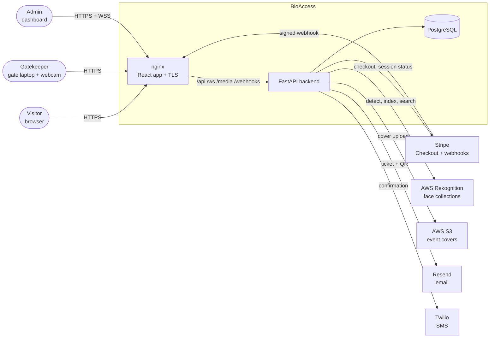
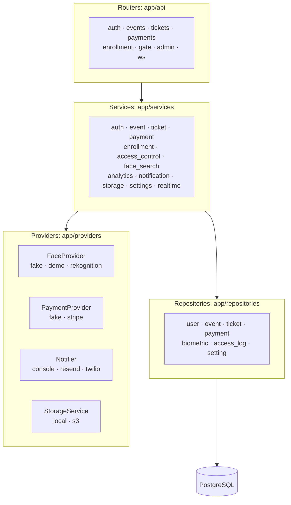
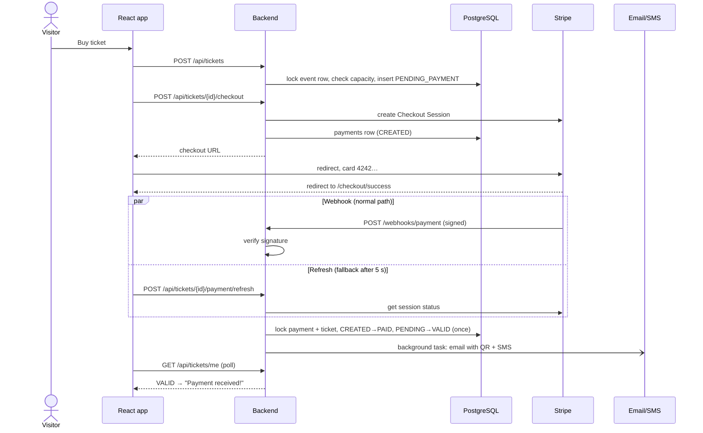
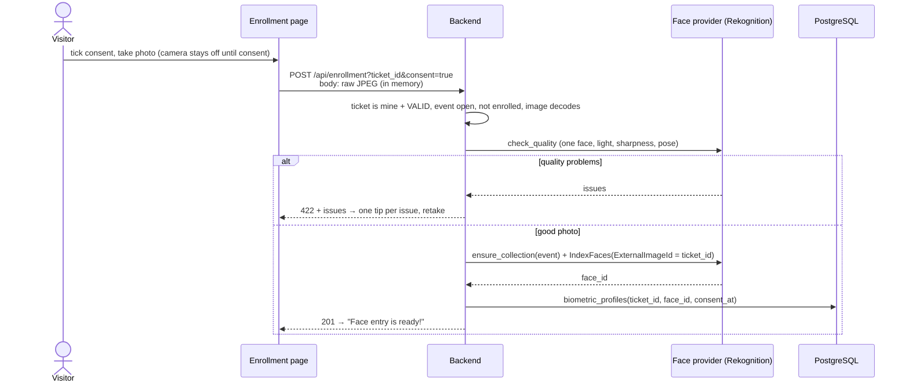
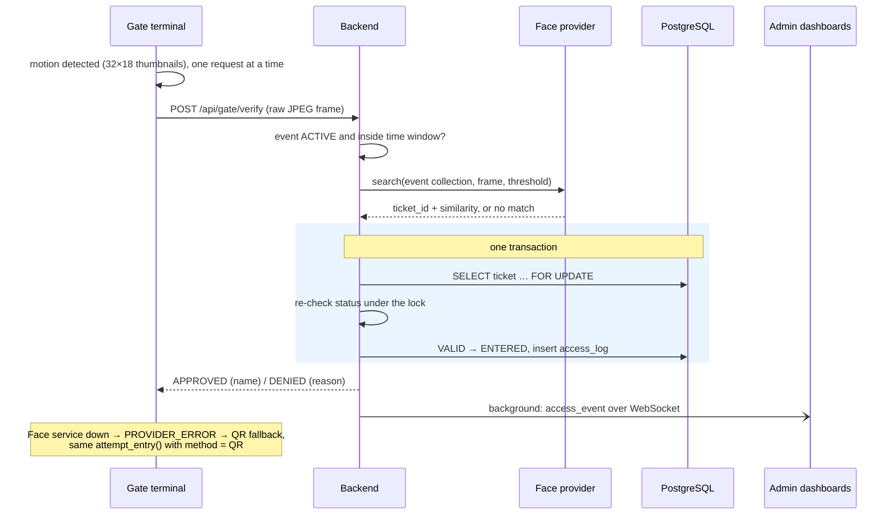
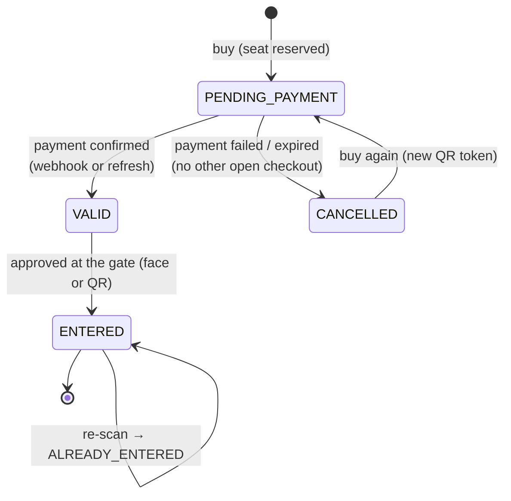
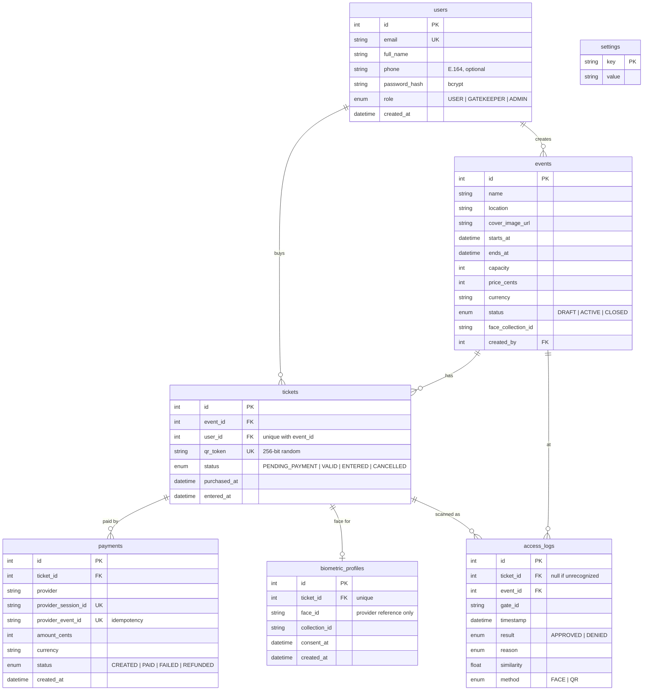
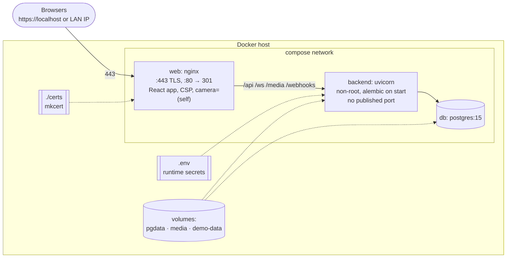

# BioAccess — Architecture

Diagrams for the project book. They are written in [Mermaid](https://mermaid.js.org/), so they
render on GitHub and in VS Code and stay next to the code; SVG exports are in
[`diagrams/`](diagrams/) (regenerate with `docs/export-diagrams.sh`).

1. [System context](#1-system-context)
2. [Backend layers and provider interfaces](#2-backend-layers-and-provider-interfaces)
3. [Purchase flow](#3-purchase-flow)
4. [Face enrollment flow](#4-face-enrollment-flow)
5. [Gate verification flow](#5-gate-verification-flow)
6. [Ticket state machine](#6-ticket-state-machine)
7. [Data model](#7-data-model)
8. [Docker deployment](#8-docker-deployment)

---

## 1. System context

Who talks to whom. Every external service sits behind an interface with a free fake/console
implementation, selected in `.env`.

## 2. Backend layers and provider interfaces

Routers only translate HTTP; business rules live in services; SQL lives in repositories.
External services are Strategy/Adapter interfaces with a fake and a real implementation.

## 3. Purchase flow

The ticket becomes `VALID` exactly once, whichever arrives first: Stripe's webhook or the
success page's refresh call (for a webhook that never arrives). Both use the same locked,
idempotent code.

## 4. Face enrollment flow

The photo exists only in memory: it is read from the raw request body (never a temp file),
sent to the provider, and dropped. Only the provider's `face_id` is stored.

## 5. Gate verification flow

The slow network call happens before any lock. The entry itself is one short transaction
with `SELECT … FOR UPDATE`, so parallel gates admit a ticket exactly once (tested with 10
threads, and with face and QR mixed).

## 6. Ticket state machine

## 7. Data model

No column can hold an image or a face vector (checked by `test_case_10`): faces are only
referenced by the provider's `face_id`.

## 8. Docker deployment

Only nginx is published. The backend trusts nginx's forwarded headers (it can't be reached
otherwise), so rate limits see the real client IP. Secrets are passed at runtime from `.env`,
never baked into images.

